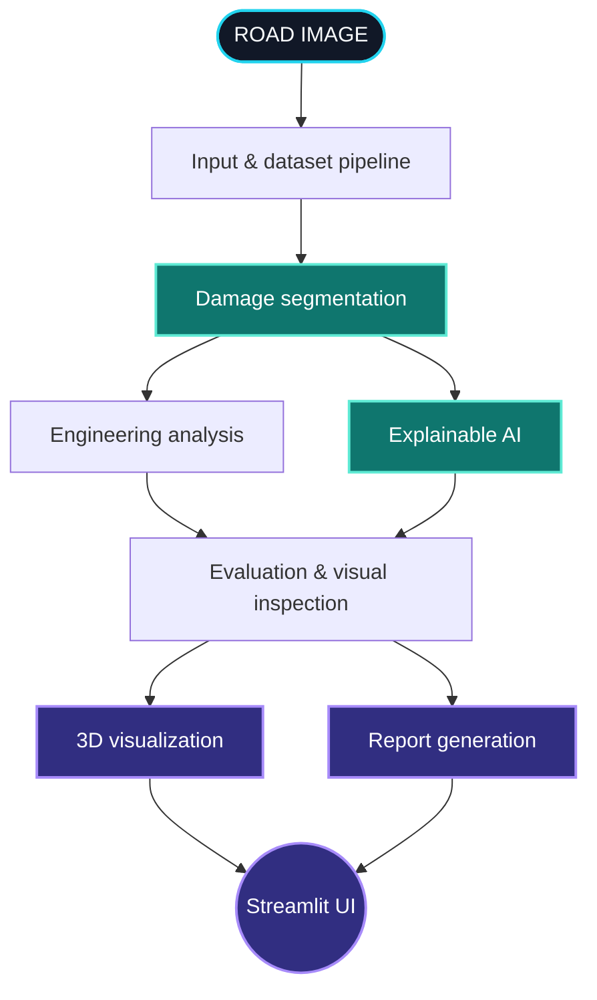

<!--
  ROADXAI • README EXPERIENCE
  GitHub-compatible effects: animated SVG headers/typing, live badges,
  expandable details, anchor navigation, and native Mermaid diagrams.
-->

<div align="center">

<a href="https://roadxai.streamlit.app/">
  
</a>

<a href="https://readme-typing-svg.demolab.com?font=JetBrains+Mono&weight=700&size=20&duration=2300&pause=650&color=2DE2E6&center=true&vCenter=true&width=900&height=50&lines=SEE+THE+DAMAGE.;TRACE+THE+PREDICTION.;EXPLORE+THE+EVIDENCE.;TURN+VISION+INTO+INSIGHT.">
  
</a>

<p><strong>An explainable computer-vision toolkit for road-surface inspection.</strong></p>
<p>Segmentation · Engineering-oriented analysis · Explainable AI · Evaluation · 3D visualization · Reporting</p>

[](https://roadxai.streamlit.app/)
[](https://github.com/VasuML07/RoadXAI)
[](https://www.python.org/)

<br/>

[Overview](#-mission-control) · [Pipeline](#-follow-the-signal) · [Capabilities](#-what-lives-inside) · [Data](#-data--model-artifacts) · [Install](#-boot-it-locally) · [Source map](#-jump-into-the-code)

<br/>


</div>

---

## ◈ MISSION CONTROL

> **Road damage is visible. Reliable interpretation is the challenge.**
>
> RoadXAI explores a modular workflow for turning road imagery into segmentation outputs, visual explanations, inspection-oriented analysis, evaluation artifacts, 3D views, and reports.

<table>
<tr>
<td width="50%" valign="top">

### ◉ THE SIGNAL

- **Segment** damage regions from image inputs.
- **Analyze** outputs with engineering-oriented utilities.
- **Explain** model predictions with visual interpretation tools.

</td>
<td width="50%" valign="top">

### ◉ THE OUTPUT

- **Evaluate** saved results and model behavior.
- **Visualize** supported outputs in 3D-oriented views.
- **Report** information from the inspection workflow.

</td>
</tr>
</table>

<details>
<summary><strong>▸ Open the project brief</strong></summary>

RoadXAI is a research and engineering project—not a certified road survey system. Results vary with image quality, viewpoint, lighting, dataset coverage, model weights, and configuration. Generated measurements and severity-related outputs need appropriate validation and human review before real-world use.

</details>

## ◈ FOLLOW THE SIGNAL

Explore the processing flow below. The diagram is defined in Mermaid so the source stays editable alongside the code.



<details>
<summary><strong>▸ Decode each stage</strong></summary>

| Stage | Purpose | Code |
|---|---|---|
| Input preparation | Data and input validation utilities | [`dataset_pipeline/`](dataset_pipeline/) |
| Segmentation | CNN segmentation implementation | [`cnn_model/`](cnn_model/) |
| Engineering analysis | Inspection-oriented analysis utilities | [`engineering_analysis/`](engineering_analysis/) |
| Explainability | Methods and helpers for visual interpretation | [`explainable_ai/`](explainable_ai/) |
| Evaluation | Evaluation logic and metrics utilities | [`evaluation/`](evaluation/) |
| 3D visualization | 3D visualization code | [`3d_visualization/`](3d_visualization/) |
| Reporting | Report-generation implementation | [`report_generation/`](report_generation/) |
| Application | Streamlit app and workflow coordination | [`streamlit_app/`](streamlit_app/) |

</details>

## ◈ WHAT LIVES INSIDE

<table>
<tr>
<td width="50%" valign="top">

### 🧠 Vision layer

**CNN segmentation**

Model implementation and image-processing helpers.

[Explore module ↗](cnn_model/)

---

**Dataset pipeline**

Preparation and validation utilities for the supported workflows.

[Explore module ↗](dataset_pipeline/)

---

**Explainable AI**

Tools to inspect and interpret predictions.

[Explore module ↗](explainable_ai/)

</td>
<td width="50%" valign="top">

### 🛰️ Inspection layer

**Engineering analysis**

Analysis utilities built around the prediction workflow.

[Explore module ↗](engineering_analysis/)

---

**3D visualization**

Code for supported 3D-oriented visualizations.

[Explore module ↗](3d_visualization/)

---

**Reports & evaluation**

Evaluation logic, saved artifacts, and report creation.

[Evaluation ↗](evaluation/) · [Reports ↗](report_generation/)

</td>
</tr>
</table>

<details>
<summary><strong>▸ Inspect the repository layout</strong></summary>

```text
RoadXAI/
├── 3d_visualization/     # 3D-oriented visualization
├── checkpoints/          # Model checkpoint artifacts
├── cnn_model/            # CNN segmentation code
├── dataset_pipeline/     # Data preparation and validation
├── deployment/           # Deployment configuration and utilities
├── engineering_analysis/ # Inspection-oriented analysis
├── evaluation/           # Evaluation implementation
├── evaluation_results/   # Saved evaluation artifacts and notes
├── explainable_ai/       # Explainability methods
├── project_overview/     # Shared configuration, paths, schemas
├── report_generation/    # Report creation
├── streamlit_app/        # Streamlit application
├── training_pipeline/    # Training workflow
├── requirements.txt
└── README.md
```

</details>

## ◈ DATA & MODEL ARTIFACTS

| Dataset / workflow | Checkpoint folder | Evaluation artifact |
|---|---|---|
| **CRACK500** | [`checkpoints/crack500/`](checkpoints/crack500/) | [`CRACK500.json`](evaluation_results/CRACK500.json) |
| **Pothole Segmentation YOLOv8** | [`checkpoints/pothole_yolov8/`](checkpoints/pothole_yolov8/) | [`Pothole_Segmentation_YOLOv8.json`](evaluation_results/Pothole_Segmentation_YOLOv8.json) |
| **Public Pothole Dataset** | [`checkpoints/public_pothole/`](checkpoints/public_pothole/) | [`PUBLIC_POTHOLE_DATASET.json`](evaluation_results/PUBLIC_POTHOLE_DATASET.json) |

<details>
<summary><strong>▸ Read this before comparing metrics</strong></summary>

Checkpoint names and saved evaluation artifacts alone do not establish comparable real-world performance. Before interpreting or reproducing a metric, inspect the corresponding model definition, preprocessing, label mapping, data split, evaluation method, and hardware setup.

- Segmentation quality does not automatically validate physical measurements.
- Explainability visualizations should be interpreted as model-inspection aids, not proof of causality.
- 3D visuals are not metrically accurate unless the geometry is calibrated and independently validated.

See [evaluation documentation](evaluation/Evaluation.md) and [evaluation analysis](evaluation_results/Evaluation_Results_Analysis.md).

</details>

## ◈ BOOT IT LOCALLY

<details open>
<summary><strong>▸ Step 01 — Clone the repository</strong></summary>

```bash
git clone https://github.com/VasuML07/RoadXAI.git
cd RoadXAI
```

</details>

<details>
<summary><strong>▸ Step 02 — Create a virtual environment</strong></summary>

**Windows PowerShell**

```powershell
python -m venv .venv
.\.venv\Scripts\Activate.ps1
python -m pip install --upgrade pip
```

**macOS / Linux**

```bash
python3 -m venv .venv
source .venv/bin/activate
python -m pip install --upgrade pip
```

</details>

<details>
<summary><strong>▸ Step 03 — Install requirements</strong></summary>

```bash
pip install -r requirements.txt
```

</details>

<details>
<summary><strong>▸ Step 04 — Launch the app</strong></summary>

```bash
streamlit run streamlit_app/app.py
```

Open the local address displayed in your terminal.

</details>

> [!TIP]
> If a package fails to install, check the first error and verify the Python version against [`requirements.txt`](requirements.txt). If a checkpoint cannot be loaded, verify the file path, architecture, and library versions expected by the selected module.

## ◈ JUMP INTO THE CODE

| Want to inspect… | Open this |
|---|---|
| Streamlit UI | [`streamlit_app/app.py`](streamlit_app/app.py) |
| App documentation | [`Streamlit_Application.md`](streamlit_app/Streamlit_Application.md) |
| CNN model details | [`CNN_Segmentation.md`](cnn_model/CNN_Segmentation.md) |
| Dataset workflow | [`Dataset_Pipeline.md`](dataset_pipeline/Dataset_Pipeline.md) |
| Engineering analysis | [`Engineering_Analysis.md`](engineering_analysis/Engineering_Analysis.md) |
| Explainability | [`Explainable_AI.md`](explainable_ai/Explainable_AI.md) |
| Evaluation | [`Evaluation.md`](evaluation/Evaluation.md) |
| 3D visualization | [`3D_Visualization.md`](3d_visualization/3D_Visualization.md) |
| Report generation | [`Report_Generation.md`](report_generation/Report_Generation.md) |
| Project architecture | [`RoadXAI_Project.md`](project_overview/RoadXAI_Project.md) |

## ◈ NEXT TRANSMISSION

These are suggested improvements—not claims that every item is already implemented.

- [ ] Add short, representative GIF demos of the real app workflows.
- [ ] Publish reproducible benchmarks with dataset splits, metrics, and hardware details.
- [ ] Document calibration and uncertainty for any physical measurements.
- [ ] Add automated tests for validation, inference, and report generation.
- [ ] Evaluate robustness across lighting, weather, cameras, and road surfaces.

## ◈ RESPONSIBLE USE

RoadXAI is intended for research and decision-support workflows. Lighting, viewpoint, image resolution, shadows, water, road texture, dataset bias, and model generalization can affect the outputs. Any generated measurement, severity estimate, explanation, or report should be reviewed by a qualified person and validated against ground truth before operational use. Do not use this project as the sole basis for road closure, emergency response, infrastructure certification, or other public-safety decisions.

---

<div align="center">

### **THE ROAD IS THE INPUT. THE EVIDENCE IS THE OUTPUT.**

<a href="https://roadxai.streamlit.app/"></a>
<a href="https://github.com/VasuML07/RoadXAI"></a>

<sub>Built by <a href="https://github.com/VasuML07">VasuML07</a> · Computer Vision · Deep Learning · Explainable AI</sub>


</div>
